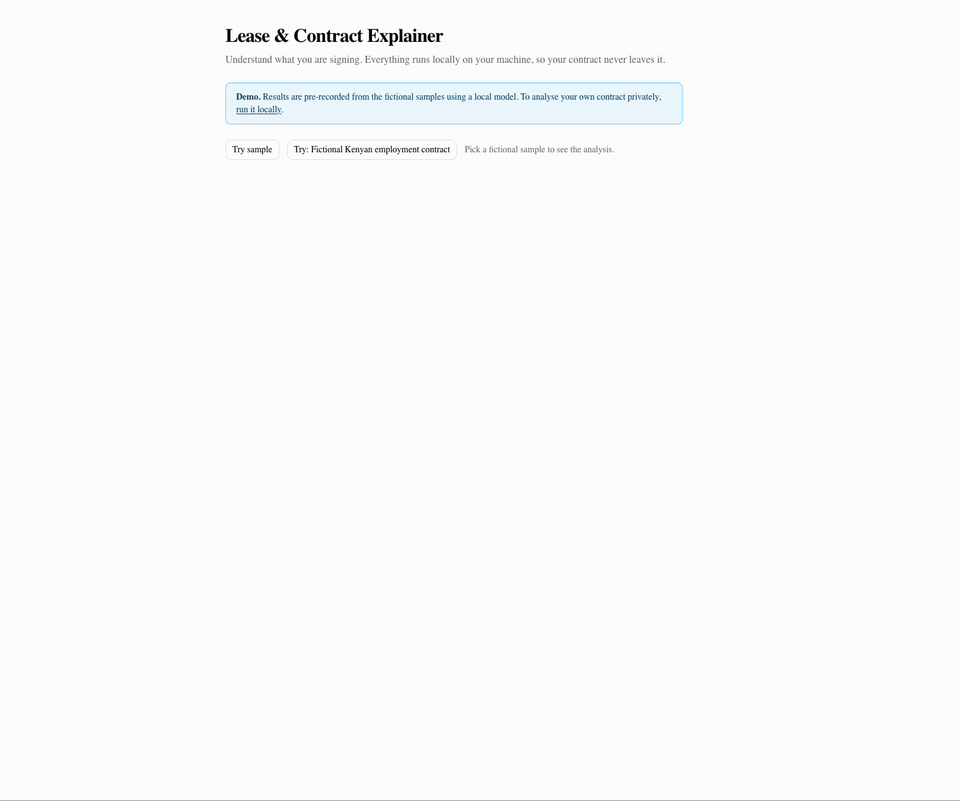
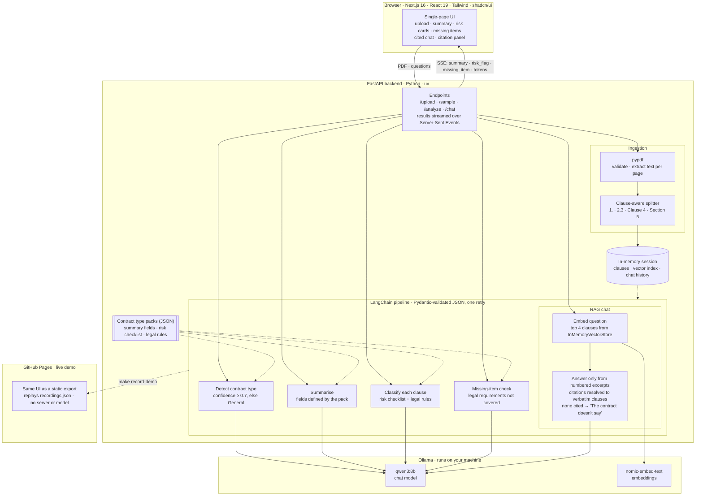

# Lease & Contract Explainer

**An AI contract reviewer that explains what you're signing, flags risky clauses, and answers questions with citations to the exact clause. It runs entirely on your own machine.**

### ▶ [Live demo](https://christinewanjau.github.io/lease-contract-explainer/)

> The live demo replays **pre-recorded results** from two fictional sample contracts, so it needs no server or model. The full app runs locally with [Ollama](https://ollama.com), so a real contract never leaves your computer. See [Run it locally](#run-it-locally).



> ⚠️ **Not legal advice.** This is an automated explanation that may be incomplete or wrong. For important decisions, consult a qualified lawyer.

---

## What this project demonstrates

| Skill | Where it shows up |
|---|---|
| **Retrieval-augmented generation (RAG)** | The chat embeds each clause, retrieves the most relevant ones for a question, and answers only from them. [`chat.py`](backend/src/lce/chat.py) |
| **Grounded citations (no invented quotes)** | The model cites numbered excerpts like `[1]`; those are resolved back to the stored clause text, so every quote is verbatim from the contract. Answers that cite nothing are replaced with "The contract doesn't say." [`cited()` in `chat.py`](backend/src/lce/chat.py) |
| **Embeddings and vector search** | `OllamaEmbeddings` (`nomic-embed-text`) with LangChain's `InMemoryVectorStore`, one index per contract. [`ContractIndex`](backend/src/lce/chat.py) |
| **Structured output with validation** | Summaries, risk flags and type detection are JSON checked against Pydantic models, with one retry on invalid output. Summary schemas are generated from config. [`analysis.py`](backend/src/lce/analysis.py), [`packs.py`](backend/src/lce/packs.py) |
| **Classification with a confidence fallback** | Uploads are classified into a contract type; below 0.7 confidence, an unknown type or invalid output, it falls back to General instead of guessing. [`detect.py`](backend/src/lce/detect.py) |
| **Domain knowledge from config, not the model** | Contract types are JSON "packs" with their own summary fields, risk checklist and legal rules. Legal details (Act, section, link) always come from config; the model only decides whether a rule applies. [`data/packs/`](backend/src/lce/data/packs/) |
| **Prompt design** | Per-clause classification, whole-contract summarisation, "is this requirement missing?" checks, and grounded Q&A, each with an explicit JSON contract. [`analysis.py`](backend/src/lce/analysis.py), [`chat.py`](backend/src/lce/chat.py) |
| **Streaming** | Results stream to the browser over Server-Sent Events: the summary first, then risk cards one by one, then chat answers token by token. [`app.py`](backend/src/lce/app.py) |
| **Running a local LLM** | `qwen3:8b` through Ollama, with "thinking" turned off by default after measuring it ~5× slower for the same results. [`main.py`](backend/src/lce/main.py) |
| **Testing LLM code** | The model and embeddings are injected into the app, so 120 tests run against LangChain's fake models in CI, with no Ollama needed. [`tests/`](backend/tests/) |
| **Guardrails** | Upload validation, citations that can't be invented, legal rules that can't activate while they contain placeholders, and an "unverified rule" warning until a professional reviews them. |

---

## Architecture



**How a contract flows through it**

1. **Ingest:** the PDF is validated (10 MB, 30 pages, readable, has selectable text) and split into clauses with their page numbers.
2. **Detect:** the model picks a contract type from the configured packs. Below 0.7 confidence it falls back to General.
3. **Analyse:** a summary with the pack's fields, then one model call per clause for risks and legal rules, then a check for required items the contract leaves out. Each result streams to the browser as soon as it's ready.
4. **Chat (RAG):** clauses are embedded once; each question retrieves the 4 most relevant, and the model answers only from them. Its `[n]` references are resolved back to the stored clauses, so quotes are always verbatim.

The models are passed into `create_app(llm=..., embeddings=...)`. Production uses Ollama; the 120 tests use LangChain's fake models, so CI needs no model. Swapping in another LangChain chat model is a one-line change.

---

## Features

- **Upload a PDF** with clear errors for non-PDFs, files over 10 MB or 30 pages, damaged files and scanned PDFs, or **try a fictional sample**.
- **Automatic contract type detection** ("Looks like a Kenyan employment contract. Change?").
- **Plain-language summary** with fields chosen by the contract type.
- **Risk flags** with severity, why it matters, a question to ask before signing, and a clickable citation.
- **Legal-rule checks and "Missing from your contract"** items that cite the Act and section, with an "unverified rule" warning.
- **Cited Q&A chat** with follow-up questions and example questions per contract type.

### Contract types

| Pack | Summary fields | Risk checklist |
|---|---|---|
| **General** | Parties, duration, key dates, payments, obligations | Early termination, automatic renewal, deposit forfeiture, one-sided liability, price increases, restrictive covenants, notice periods, unilateral changes |
| **Kenyan employment** | Job title, salary, working hours, leave, probation, notice, and more | Probation, dismissal without a hearing, non-compete, pay deductions, unpaid overtime, transfers, unilateral changes, ownership of your work |

The Kenyan employment pack also has 6 legal rules (annual leave, sick leave, maternity and paternity leave, notice, probation length, written particulars). They're **placeholders**: their figures and sections must be filled in from the Employment Act, 2007 before they switch on.

---

## Technologies

| Technology | What it does here |
|---|---|
| **[LangChain](https://github.com/langchain-ai/langchain)** (`langchain-core`, `langchain-ollama`) | Chat model and embeddings interfaces, messages, `InMemoryVectorStore`, token streaming, and fake models for tests |
| **[Ollama](https://ollama.com)** | Runs the models locally: `qwen3:8b` for chat and `nomic-embed-text` for embeddings |
| **[FastAPI](https://fastapi.tiangolo.com)** + Uvicorn | The API, request validation and Server-Sent Events streaming |
| **[Pydantic](https://docs.pydantic.dev)** | Validates model output, pack config and legal rules; generates summary schemas from config |
| **[pypdf](https://pypdf.readthedocs.io)** | PDF validation and per-page text extraction |
| **[Next.js](https://nextjs.org)** 16 + React 19 | The single-page UI; exported as static files for the live demo |
| **[Tailwind CSS](https://tailwindcss.com)** + **[shadcn/ui](https://ui.shadcn.com)** | Styling and UI components |
| **[uv](https://docs.astral.sh/uv/)**, **pytest**, **ruff** | Python packaging, tests and linting |
| **GitHub Actions** + **GitHub Pages** | CI on every push, and deployment of the live demo |

---

## Run it locally

**Requirements:** macOS or Linux, [Ollama](https://ollama.com/download), [uv](https://docs.astral.sh/uv/) and Node.js 22+. About 6 GB of disk for the models; 16 GB of RAM recommended.

```bash
# 1. Get the local models
ollama pull qwen3:8b
ollama pull nomic-embed-text

# 2. Install dependencies
make install

# 3. Start the backend (:8000) and frontend (:3000)
make dev
```

Open http://localhost:3000, upload a contract PDF or try a sample. On an Apple Silicon laptop, analysing the 2-page lease sample takes about a minute; the first chat question takes around 25 seconds while the contract is indexed, and follow-ups a few seconds.

### Configuration

| Variable | Default | Purpose |
|---|---|---|
| `LCE_CHAT_MODEL` | `qwen3:8b` | Ollama chat model |
| `LCE_EMBED_MODEL` | `nomic-embed-text` | Ollama embedding model |
| `LCE_REASONING` | `false` | Turn on qwen3 "thinking" (much slower) |
| `OLLAMA_BASE_URL` | `http://localhost:11434` | Where Ollama runs |
| `LCE_ALLOWED_ORIGINS` | `http://localhost:3000` | CORS origins for the frontend |
| `NEXT_PUBLIC_API_URL` | `http://localhost:8000` | Backend URL used by the frontend |

Contract types live in [`backend/src/lce/data/packs/`](backend/src/lce/data/packs/), one JSON file each. Add a pack file and list it in `BUNDLED_PACKS` in [`packs.py`](backend/src/lce/packs.py) to support a new contract type. Invalid packs stop the app at startup with a clear error.

### Commands

```bash
make test         # backend tests (no Ollama needed)
make check        # tests + ruff + typecheck + ESLint + Next.js build (same as CI)
make sample       # regenerate the fictional sample PDFs
make record-demo  # re-record the live demo from the real backend on local Ollama
make demo-build   # build the frontend in demo mode
```

---

## Testing

The app is tested through two agreed boundaries rather than its internals:

- **The HTTP API, with fake models injected.** Upload rejections, streamed event order, schema validation and retries, verbatim citations, "the contract doesn't say", chat history, type detection and its fallbacks, legal rules taking their details only from config, and model failures.
- **The clause splitter as a pure function.** Numbering styles, sub-items, page breaks, preambles and the fixed-size fallback.

A further test keeps the live demo honest: it fails CI if the recordings drift from the current packs, sample contracts or event formats.

---

## Project layout

```
backend/
  src/lce/
    app.py        # app factory, endpoints, SSE streaming
    main.py       # wires the Ollama models into the app
    pdf.py        # PDF validation and text extraction
    splitter.py   # clause-aware splitter
    packs.py      # contract type packs and legal rules (config + validation)
    detect.py     # automatic contract type detection
    analysis.py   # summary, risk flags, legal rules, missing items
    chat.py       # retrieval and cited answers (RAG)
    data/packs/   # one JSON file per contract type
  scripts/        # sample PDF generator, demo recorder
  tests/
frontend/
  src/app/page.tsx      # single-page UI
  src/components/       # summary card, risk cards, citation panel, chat
  src/lib/api.ts        # API client and SSE parsing
  src/demo/             # demo mode and its recordings
```

---

## How it was built

I built this with an AI coding assistant, using an issue-driven workflow:

1. **Planning interviews** to settle scope and design decisions before writing code.
2. **Specs as GitHub issues**, split into small, demoable tickets with blocking links.
3. **Test-driven development**: failing tests first, at agreed boundaries, then the code.
4. **Pull requests with CI**, plus a manual check of each feature against the real local model.

The specs and tickets are in this repo's [issues](https://github.com/ChristineWanjau/lease-contract-explainer/issues?q=is%3Aissue).

---

## Limitations and future work

- **Legal rules are placeholders.** The Kenyan employment rules need their figures and sections filled in from the Act, and a professional review, before they switch on.
- **No evaluation set yet.** Risk-flag and answer quality has been checked by hand on the samples. A labelled set with precision/recall scoring is the next step.
- **The live demo is recorded, not live.** It shows real model output from the samples only; running it locally is needed to analyse your own contract or ask your own questions.
- **The missing-item check can over-report.** In testing it marked a requirement as missing when the contract did cover it.
- **Text PDFs only.** Scanned PDFs are rejected; OCR would fix that. DOCX isn't supported.
- **One contract per session, in memory.** Nothing is saved.
- **The full app needs Ollama** and a reasonably powerful machine.
