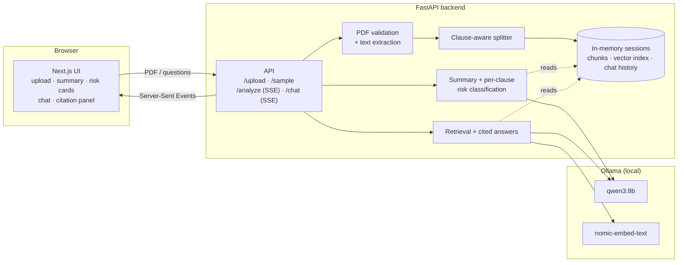

# Lease & Contract Explainer

**Understand what you're signing, without sending your contract to anyone.**

Upload a lease or contract PDF and get a plain-language summary, the risky clauses flagged with severity, and a chat that answers your questions, every answer citing the exact clause it came from. Everything runs **locally** on [Ollama](https://ollama.com): your contract never leaves your machine.


> ⚠️ **Not legal advice.** This tool gives an automated explanation that may be incomplete or wrong. For important decisions, consult a qualified lawyer.

## Why

People sign leases and employment contracts they didn't write and don't fully understand. The costly terms (automatic renewals, deposit forfeiture, steep exit fees, one-sided liability) hide in dense legal language. A lawyer is expensive for routine contracts, and pasting a contract into a cloud chatbot means sharing names, addresses, salaries and ID numbers with a third party.

## Features

- **Contract types**: a general pack for any contract, plus a **Kenyan employment contract** pack with its own summary fields (job title, salary, working hours, leave, probation, notice) and risk checklist (probation, dismissal without a hearing, non-compete, pay deductions, unpaid overtime, transfers, unilateral changes, ownership of your work). Uploads are classified automatically, falling back to the general pack when unsure.
- **Plain-language summary**: the fields that matter for the contract type, such as parties, key dates, payments, duration and your obligations for a general contract.
- **Risk flags**: each clause is checked against the contract type's configurable checklist (for a general contract: early termination, automatic renewal, deposit forfeiture, one-sided liability, price increases, restrictive covenants, notice periods, unilateral changes). Each flag has a severity, why it matters, and a question to ask before signing.
- **Cited Q&A chat**: ask follow-up questions; answers use only your contract and cite clause and page. If the contract doesn't cover it, it says so instead of guessing.
- **Verifiable citations**: click any citation to see the exact quoted clause. Quotes are copied from the contract, never generated by the model.
- **Streaming**: the summary, risk cards and chat answers appear as they're produced, so a local model still feels responsive.
- **Private by design**: local models, no accounts, nothing written to disk. Sessions live in memory and vanish when the server stops.

## Architecture



**How a contract flows through the app**

1. **Ingest**: the PDF is validated (type, 10 MB / 30 pages, readable, has selectable text) and its text is extracted page by page.
2. **Split**: a clause-aware splitter detects headings like `1.`, `2.3`, `Clause 4` and `Section 5`, keeps sub-items like `(a)` inside their clause, and tracks page numbers. Unnumbered text falls back to overlapping fixed-size chunks.
3. **Analyze** (`/analyze`, streamed): the model produces a schema-validated summary, then checks each clause against the risk checklist. Invalid output is retried once; a clause that still fails is skipped and reported rather than stopping the analysis.
4. **Chat** (`/chat`, streamed): clauses are embedded into an in-memory vector store; the top matches are given to the model as numbered excerpts. The model cites them as `[1]`, `[2]`; those references are resolved back to the stored clauses. An answer that cites nothing is replaced with "The contract doesn't say."

### LangChain in this project

| Concept | Where |
|---|---|
| Chat models (`ChatOllama`) and embeddings (`OllamaEmbeddings`) | `backend/src/lce/main.py` |
| Messages and prompts (`SystemMessage`, `HumanMessage`, `AIMessage`) | `backend/src/lce/analysis.py`, `chat.py` |
| Structured output validated with Pydantic, with retry | `backend/src/lce/analysis.py` |
| Vector store retrieval (`InMemoryVectorStore`) | `backend/src/lce/chat.py` |
| Token streaming (`llm.stream`) | `backend/src/lce/chat.py` |
| Fake models for tests (`FakeListChatModel`, `DeterministicFakeEmbedding`) | `backend/tests/` |

**Design choice: injected models.** The app is built with `create_app(llm=..., embeddings=...)`. Production passes Ollama models; tests pass LangChain's fake models. The whole API is tested without Ollama running, and the app is provider-agnostic: swapping in another LangChain chat model is a one-line change.

## Run it locally

**Requirements:** macOS or Linux, [Ollama](https://ollama.com/download), [uv](https://docs.astral.sh/uv/), Node.js 22+. About 6 GB of disk for the models; 16 GB RAM recommended.

```bash
# 1. Get the local models
ollama pull qwen3:8b
ollama pull nomic-embed-text

# 2. Install dependencies
make install

# 3. Start backend (:8000) and frontend (:3000)
make dev
```

Open http://localhost:3000 and click **Try sample** to load a fictional lease with planted risky clauses, try the fictional Kenyan employment contract, or upload your own PDF. Uploads are classified automatically ("Looks like a Kenyan employment contract. Change?"), and you can switch the contract type at any time.

**Expect it to be slow-ish.** On an Apple Silicon laptop, the full analysis of the 2-page sample (summary and risk scan) takes about a minute. The first chat question takes around 25 seconds while the contract is indexed; follow-ups take a few seconds.

### Configuration

Set these environment variables before `make dev`:

| Variable | Default | Purpose |
|---|---|---|
| `LCE_CHAT_MODEL` | `qwen3:8b` | Ollama chat model |
| `LCE_EMBED_MODEL` | `nomic-embed-text` | Ollama embedding model |
| `LCE_REASONING` | `false` | Turn on qwen3 "thinking" (much slower, similar results on the sample) |
| `OLLAMA_BASE_URL` | `http://localhost:11434` | Where Ollama runs |
| `LCE_ALLOWED_ORIGINS` | `http://localhost:3000` | CORS origins for the frontend |
| `NEXT_PUBLIC_API_URL` | `http://localhost:8000` | Backend URL used by the frontend |

The risk checklists live in contract type **packs** under [`backend/src/lce/data/packs/`](backend/src/lce/data/packs/): one JSON file per type, each with its summary fields, risk categories and sample. Add a category to a pack to start flagging it, or add a pack file (and list it in `BUNDLED_PACKS` in `backend/src/lce/packs.py`) to support a new contract type.

## Development

```bash
make test    # backend tests (no Ollama needed)
make check   # tests + ruff + typecheck + ESLint + Next.js build (same as CI)
make sample  # regenerate the fictional sample lease PDF
```

**Testing approach.** Tests exercise behaviour through two agreed seams, not internals:

- **The HTTP API** with fake models injected: upload rejections, streamed event order, schema validity, retry-then-error, verbatim citations, "the contract doesn't say", chat history, model failures.
- **The clause splitter** as a pure function: numbering styles, sub-items, page breaks, preambles, and the fixed-size fallback.

CI (GitHub Actions) runs the backend tests and lint, and the frontend type-check, lint and build, on every push and pull request.

### Project layout

```
backend/
  src/lce/
    app.py        # app factory, endpoints, SSE streaming
    main.py       # wires Ollama models into the app
    pdf.py        # PDF validation + text extraction
    splitter.py   # clause-aware splitter
    packs.py      # contract type packs (config loading + validation)
    detect.py     # automatic contract type detection
    analysis.py   # summary + risk flags
    chat.py       # retrieval + cited answers
    data/         # packs/*.json, sample PDFs
  tests/
  scripts/make_sample.py
frontend/
  src/app/page.tsx      # single-page UI
  src/components/       # summary card, risk cards, citation panel, chat
  src/lib/api.ts        # API client + SSE parsing
```

## Limitations and future work

- **Text PDFs only.** Scanned PDFs are rejected; OCR would fix that. DOCX isn't supported.
- **One contract per session, in memory.** Nothing is saved; there's no history of past contracts.
- **No evaluation set yet.** Risk-flag quality is checked by hand on the sample. A labelled set of public contracts with precision/recall scoring is the next step.
- **General checklist.** Not tuned to any jurisdiction or contract type.
- **Citations show the clause text, not a highlight in the PDF.**
- **Local only.** No Docker or hosted deployment: a public demo would need a hosted model, which breaks the "your data stays on your machine" promise.

## Built with

[LangChain](https://github.com/langchain-ai/langchain) · [Ollama](https://ollama.com) · [FastAPI](https://fastapi.tiangolo.com) · [Next.js](https://nextjs.org) · [Tailwind CSS](https://tailwindcss.com) · [shadcn/ui](https://ui.shadcn.com) · [pypdf](https://pypdf.readthedocs.io) · [uv](https://docs.astral.sh/uv/)
